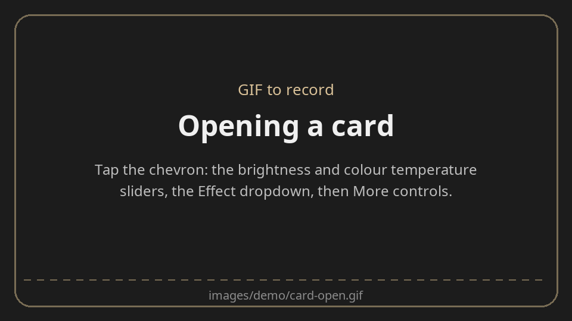
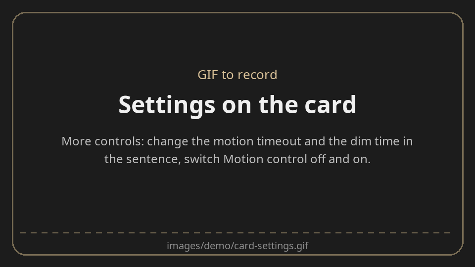
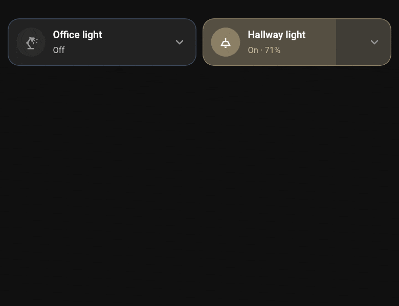

<p align="center">
  
</p>

# Knit

**Lights that look after themselves, without writing a single automation.**

Knit is a Home Assistant integration that knits the sensors you already have (motion, door
contacts, vibration, light level) to the lights you already have, and gives each one a dashboard card. Tell it which light,
which sensors, and it does the rest: on when someone walks in (or a door opens) and it's dark, a
countdown once the room is empty, a gentle dim as a warning, then off.


## What it's good for

- **Rooms that light themselves.** Walk in, the light comes on (only if it's dark). Walk out, it
  goes off a few minutes later.
- **Cupboards, sheds and desks.** A door contact lights a cupboard while it's open; a vibration
  sensor keeps a desk lamp on while you're working.
- **No more lights left on.** Everything Knit turns on, it also turns off, with a countdown you can
  see on the card.
- **No surprises.** Before a light goes off it dims to half for the last part of the countdown.
  Move, and it comes straight back to where it was.
- **Daylight.** A light that's on when the room gets bright switches itself off; a lamp that
  follows the light level alone comes on at dusk.
- **Things that should never be left on.** A heater, a fan or a decorative light on a smart plug
  can be set to go off once nobody's around, without ever being turned on for you.
- **A tidy dashboard.** Cards that open in place to show the controls, and section headers that
  fold a whole group of cards away until you need them.

## Who it's for

**If you're new to Home Assistant**, Knit replaces the hardest part of getting started. A
motion light done by hand needs helpers for the timings, a timer, and two or three automations
that have to agree with each other. With Knit you fill in one form per light. Every setting
(how long, how dark, how much warning) is a number or a switch on the card, so you tune a room by
living in it rather than by editing YAML.

**If you've been here a while**, Knit is a small, predictable engine that you can build around.

- Everything it knows is an entity: the settings (numbers and switches), whether the room counts
  as occupied or dark, the averaged light level, and when each countdown ends. Use them in your
  own automations, scripts and dashboards.
- Any on / off sensor can be a trigger, either way round (on while a door is closed, on while
  nothing moves). Several count as one: the light is on while any of them says so.
- Several light sensors are averaged, so a room with
  no sensor of its own can follow the rooms around it.
- A **pause** list (guest mode, a "nobody home" helper, a cinema scene) stands Knit down for a
  light: any of them on, or only once all of them are.
- A device can be moved to a different light later and keeps its settings, entities and cards.
- The cards are plain YAML underneath, with a visual editor on top. They also work without the
  integration, pointed at your own helpers.
- The decisions live in one dependency-free Python module with unit tests.

## What it does

### Sets a room up in one form

Settings → Devices & services → Add integration → **Knit**, once per light. Pick the light (or
the switch of a plug-in lamp), the sensors that turn it on and the light sensors. A light only gets the
features for the sensors you give it: no light sensor, no light-level settings to get wrong.


The form asks for three things, and only the light is required:

| Field | What to pick |
|---|---|
| Light or switch | The light, or the switch of a plug-in lamp |
| Sensors that turn it on | Motion, presence, a door or window contact, vibration: it's on while any of them is on |
| Light level sensors | One or more, averaged. Leave empty and the light ignores daylight |

Everything else is folded away under **Advanced options**, which most lights never need:

| Advanced option | What it's for |
|---|---|
| Sensors that turn it on while off (inverted) | The other way round: on while a door is closed, or while nothing is moving |
| Pause while these are on | Guest mode, a "nobody home" helper: Knit leaves the light alone meanwhile. With two or more, Configure asks whether any or all of them pause it |
| Brightness is managed by something else | Tick it for a light run by Adaptive Lighting or your own brightness automations |
| Turn its automatic features on now | Untick it if an automation still controls the light |

Advanced options opens by itself in Configure when a device uses any of them. (The recording was
made before 0.9.2, when every field was on one page.)

### Countdown and dim

When the room empties (or the door closes, or the vibration stops), the **motion timeout** starts (5 minutes unless you change it). The ring
round the card's icon drains as it counts down, and the card says "Off in 4:12".

For the last part of the countdown (the **dim before off**, 1 minute by default, at most three
quarters of the timeout) the light dims to half. That's the warning: if you're still there, move,
(or open the door again) and the brightness goes back to what it was. If nobody does, the light goes off, and the next
time it comes on it's at its own brightness, not the dimmed one, even if Home Assistant restarted
in between. Lights that can't be dimmed skip the dim and just count down.


### Light level

Give a light one or more light sensors and it follows the daylight:

- Its sensors only turn it on while the room is **dark** (below *Dark below*).
- Once the room has been **light** (above *Light above*) for the *Off when light* time, it goes
  off, with its own countdown on the card. The gap between the two levels stops it flickering on
  and off at dusk.
- With Motion control switched off, the light level works by itself: on when it gets dark, off
  when it gets light.


### A card for each device

Tap the tile to switch the light, drag across it to dim. The chevron opens the card in place:
sliders for brightness, colour temperature and colour, a dropdown for effects, and any other
entities you want alongside (a power reading, a scene picker).



**More controls** holds the settings, written as sentences you can edit: "Motion detected turns
the light on, it goes off after `05:00` mins, and will dim `01:00` mins before turning off."
Change a time, flip Motion control or Light level off for the evening: it takes effect at once.
The group is named and worded for the sensor behind it, so a cupboard light reads **Door control**,
"Opening the door turns the light on, it goes off `05:00` mins after it closes". Once a room is
tuned, either group can be hidden from the card and carries on working.



An open card keeps its tile's outline, dashed, so it's clear which card the panel belongs to. A
half-width card spreads its panel across the whole row while it's open, and puts everything back
when it closes.



### Sections that fold away

The **section card** is a header for a group of cards. Tap its title and the cards below it fold
away; tap again and they're back. A subtitle (or an entity's state) sits beside the title, and an
optional button on the right acts on anything you like ("All off").


**Making a group collapsible** takes one card. Edit the dashboard, press **+** in the section,
choose **By card**, search for **Knit Section**, give it a title and save. A new card lands at the
bottom of its section, so drag the header to the top: every card below it, down to the next
section card or the end of the section, now folds under it. Leave edit mode and tap the title.
(While you're editing, nothing is folded, so you can always reach your cards.)


A section can hold more than one header: put a second section card further down and the cards
under each fold separately.

### Expand on a trigger

A section can stay folded until it matters. With **expand on**, it opens by itself while an
entity is in a state you choose, and stays open for a few minutes after: the cameras when
someone's at the door, the heating when a window is open, the laundry when a wash has finished.
Then it folds itself away again.


### Pause

Sometimes the house shouldn't decide. Add the entities that mean "leave this light alone" (guest
mode, a party, nobody home) and Knit stands down while they're on. The card says **Automations
paused**, so nobody wonders why the light didn't go off. When the pause ends, Knit picks up from
where things are now.


### Doors, vibration and other sensors

Motion is only one way to say "someone's here". Anything that is on or off can turn a light on, and
the same countdown and dim follow once it clears. The card names and words itself for the sensor:
**Door control**, "Opening the door turns the light on, it goes off `05:00` mins after it closes,
and will dim `01:00` mins before turning off."

| Sensor | Good for | Why the countdown and dim help |
|---|---|---|
| Door or window contact | A cupboard, wardrobe, pantry or shed: on while the door is open | A short timeout covers a door pushed to; the dim shows it's about to go off |
| Front or garage door | The hallway light when you come in (Light level keeps it for after dark) | A 5 minute timeout gives you time to take your coat off |
| Vibration sensor | A desk, workbench or armchair: on while there's movement | The timeout bridges the still moments; the dim is the nudge to move |
| Bed or chair pressure sensor | A reading lamp that's on while you're sat there | The lamp fades out a little after you get up, not the moment you lean forward |
| Doorbell or button | A porch light for a few minutes after it's pressed | The sensor is only on for a moment; the timeout is the whole point |
| Anything else | A TV's bias light, a desk lamp while the PC is on | The light outlasts a short standby instead of flicking off with it |

Every sensor can also be used **the other way round**. The set-up form has two lists (the second under Advanced options): *Sensors
that turn it on* (while they're on: motion, an open door, vibration) and *Sensors that turn it on
while off (inverted)*: a bathroom light that's on while the door is shut, a night light that comes
on when the bed sensor clears, a light that's on while nothing is moving. Sensors from both lists
can share a light: it's on while any of them says so, and counts down once none does.

What the card says for each:

| Sensor | Group | Beside it |
|---|---|---|
| Motion, presence | Motion control | Occupied / Empty · 3mins ago |
| Door, window, garage door | Door control (Window, Garage door) | Open / Closed · 3mins ago |
| Vibration | Vibration control | Vibration / Still · 3mins ago |
| Anything else, or a mix | Sensor control | Active / Clear · 3mins ago |

Not a binary sensor? An `input_boolean` helper works directly, and a threshold or template helper
makes one out of anything else (a plug's power, a media player's state).

### With Adaptive Lighting (or your own brightness automations)

If something else decides how bright a light should be, such as
[Adaptive Lighting](https://github.com/basnijholt/adaptive-lighting) or an automation of your own,
tick **Brightness is managed by something else** when you add the light (or later, in Configure).
Knit then keeps to switching:

- It turns the light on plain, with no brightness, so the other thing picks the level.
- It still dims to half as the warning before turning off.
- After a dim it hands the brightness back: Adaptive Lighting is told the light is its own again
  and applies its settings straight away. Without Adaptive Lighting, the brightness from before the
  dim is put back.
- A light that went off dimmed comes back at whatever is right now, not at its old brightness.

In Adaptive Lighting, leave *take over control* on, so it leaves the dim alone while it lasts.

### Motion-controlled devices

For something that should go off when the room empties but must never be switched on for you: a
heater, a fan, a decorative light. It takes the same sensors as a light, either way round: a fan
that goes off a few minutes after the bathroom door opens. It gets the same countdown and card, and can be told to switch
off again if it comes back on by itself after a power cut.

## Install

1. In HACS, open ⋮ → **Custom repositories**, add `https://github.com/NorseAristocrat/ha-knit` as
   an **Integration**, then install **Knit**.
2. Restart Home Assistant.
3. Settings → Devices & services → **Add integration** → Knit, once per device.

The cards come with the integration; there is nothing to add as a dashboard resource. (Dashboards
that keep their resources in YAML need `/knit_static/knit-cards.js` added by hand.)

Already have an automation running a light? Untick "Turn its automatic features on now" when you
add it to Knit, switch your automation off, then turn Knit's Motion control and Light level on, so
the two never both act on it.

## Quick start

1. Add a light in Knit with a motion sensor or a door contact (and a light sensor if you have one).
2. Edit a dashboard, add a card, and search for **Knit Light Card**. Pick the Knit device.
3. Leave the room. Watch the ring.
4. Open the card → More controls, and set the times to suit the room.

## Reference

### What a light gets

Every entity id starts `knit_` and the device's name, e.g. `switch.knit_living_room_lamp_motion`.
A device only has the entities for the sensors it was given.

| Entity | What it is | Default |
|---|---|---|
| `switch.…_motion` | Motion control (Door control, Vibration control ...) on / off | on |
| `number.…_motion_timeout` | Seconds after its sensors clear before the light goes off | 300 |
| `number.…_dim_before_off` | Seconds of that spent dimmed to half (at most 75% of the timeout) | 60 |
| `switch.…_light_level` | Light level on / off | on |
| `number.…_dark_below` | Dark below this many lx | 10 |
| `number.…_light_above` | Light above this many lx | 15 |
| `number.…_off_when_light_after` | Seconds of light before the light goes off | 300 |
| `binary_sensor.…_occupied` | Any of its trigger sensors active (on, or off for an inverted one); attributes `trigger`, `inverted` | |
| `binary_sensor.…_dark` | Dark, as its light level settings judge it | |
| `sensor.…_light_level` | The average of its light sensors (lx) | |
| `sensor.…_auto_off_ends` | When the motion timeout ends (a timestamp) | |
| `sensor.…_off_when_light_ends` | When the off-when-light countdown ends | |
| `sensor.…_light` | The light it runs; attributes `paused` and `dimmed_from` | |

The numbers and switches are under Configuration on the device page as well as on the card.

### Changing a device

**Configure** on the device changes its sensors and light sensors, and under **Advanced options**
its inverted sensors, pause entities and what it runs (*Move to another light*): the device moves
to the light you pick, keeping its settings, entities and cards. Cards set up with the device
picker follow it; a card given only `entity:` needs that changed by hand.

### The light card

The visual editor shows the Knit device, the title, icon and colour. **Panel rows** (the controls
in the open card) and **Advanced options** (corner radius, the line under the title, hiding a
group of settings, lights without Knit) fold away beneath. The YAML underneath:

```yaml
type: custom:knit-light-card       # a light or a motion-controlled device
device: <the Knit device>          # the editor's "Knit device" picker
name: Living room lamp             # optional: else the light's name
icon: mdi:floor-lamp-outline
primary: [216, 192, 151]           # the card's colour (every shade is worked out from it),
                                   # or color: sand | red | blue | green | teal | steel | purple
radius: 15                         # the card's corner radius in px (0 to 30; 15 unless set)
secondary: [state, brightness, countdown]   # the line under the name
attributes:                        # the rows in the open card, in order
  - brightness
  - color_temp
  - color
  - effect                         # a dropdown of the light's effects
  - entity: sensor.lamp_power      # any other entity: a reading, a switch, a number, a select
    name: Power
motion_control:
  hidden: true                     # keep Motion control off the card (it keeps working)
light_level:
  hidden: true
collapse_others: true              # opening this card closes the other Knit cards
wide: true                         # false: never spread across the row when open
```

Without the integration, the same card can be pointed at your own helpers (`motion:` takes
`presence`, the sensor that turns it on, and `inverted: true` if it counts while off; `motion_control:` and
`light_level:` take `enabled`, `duration`, `timer`, `dim`, `dark_below`, `light_above`,
`illuminance`, `off_after`); the editor lists them.

### The section card

The visual editor shows the title and subtitle; the **Button** and **Advanced options** (a subtitle
from an entity, how it opens) fold away beneath.

Put it first in a section of a sections view. It folds the cards below it in that section, up to
the next section card. Everything shows while the dashboard is being edited.

```yaml
type: custom:knit-section
title: Lights
subtitle: Click to expand          # shown while folded; or subtitle_entity: an entity's state, always
collapsed_by_default: false        # true: folded on every load (otherwise as it was last left)
expand_on:                         # optional: opens by itself, then folds back
  entity: binary_sensor.front_door_person
  state: "on"                      # while the entity is in this state (default on) ...
  minutes: 10                      # ... and for this long after
  minutes_entity: input_number.x   # or take the minutes from an entity
                                   # (a time entity: for this long after that time)
button:                            # optional button on the right
  entity: [light.a, switch.b]      # one or more, any domain: automations run, scripts and
  name: All off                    # scenes start, buttons press
  icon: mdi:power
  action: turn_off                 # toggle | turn_on | turn_off
  show: when_on                    # always | when_on (while any of them is on)
```

## Development

The decisions live in `custom_components/knit/engine.py`, with no Home Assistant in it:

```sh
python3 -m unittest discover tests
```

`main` is the released integration. Work that isn't ready (appliances) lives on `developer`.

## Licence

MIT: see [LICENSE](LICENSE).
