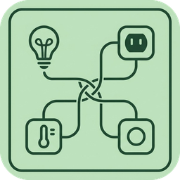
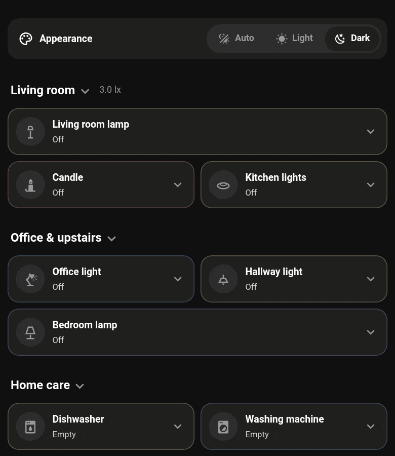
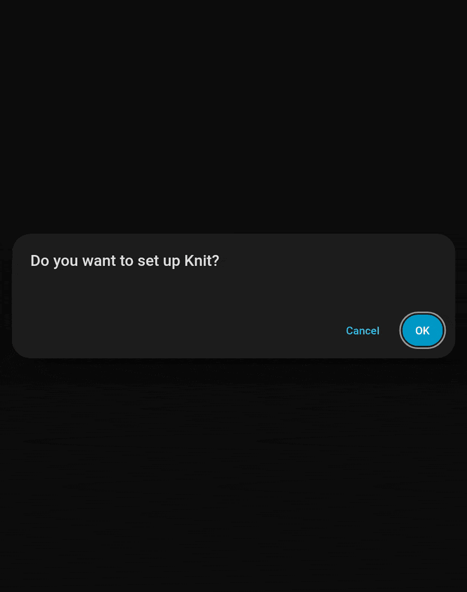
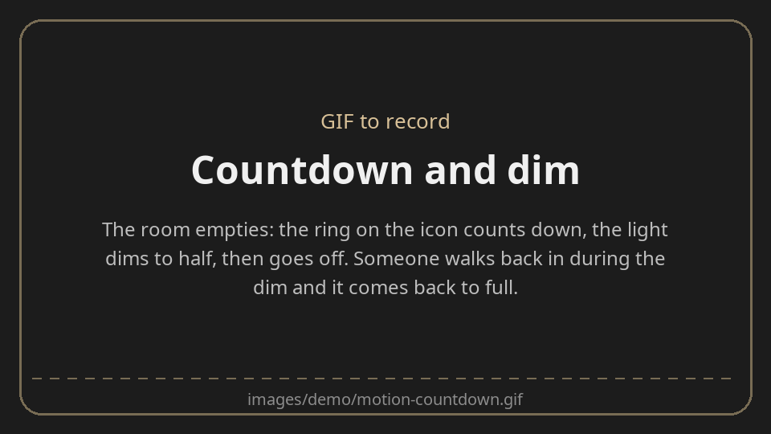

<p align="center">
  
</p>

# Knit

> **This is the `developer` branch**: everything on `main`, plus appliances, which are still
> being worked on. For the released integration, use `main`.

**Lights that look after themselves, without writing a single automation.**

Knit is a Home Assistant integration that knits the sensors you already have (motion, door
contacts, vibration, light level) to the lights you already have, and gives each one a dashboard card. Tell it which light,
which sensors, and it does the rest: on when someone walks in (or a door opens) and it's dark, a
countdown once the room is empty, a gentle dim as a warning, then off.



## What it's good for

- **Rooms that light themselves.** Walk in, the light comes on (only if it's dark). Walk out, it
  goes off a few minutes later.
- **Cupboards, sheds and desks.** A door contact lights a cupboard while it's open; a vibration
  sensor keeps a desk lamp on while you're working.
- **No more lights left on.** Everything Knit turns on, it also turns off, with a countdown you can
  see on the card.
- **No surprises.** Before a light goes off it dims to half for the last part of the countdown.
  Move, and it comes straight back to where it was.
- **Daylight.** A light that's on when the room gets bright switches itself off; a lamp that
  follows the light level alone comes on at dusk.
- **Things that should never be left on.** A fan, a decorative light or a TV on a smart plug
  can be set to go off once nobody's around, without ever being turned on for you.
- **A tidy dashboard.** Cards that open in place to show the controls, and section headers that
  fold a whole group of cards away until you need them.

## Install

1. In HACS, open ⋮ → **Custom repositories**, add `https://github.com/NorseAristocrat/ha-knit` as
   an **Integration**, then install **Knit**.
2. Restart Home Assistant.
3. Settings → Devices & services → **Add integration** → Knit, once per device.

The cards come with the integration; there is nothing to add as a dashboard resource. (Dashboards
that keep their resources in YAML need `/knit_static/knit-cards.js` added by hand.)

## Quick start

Every device is one form: Settings → Devices & services → **Add integration** → **Knit**. Only
the first field is required, and anything you skip can be added later with **Configure**.



### A room light on a motion sensor

1. Add integration → Knit → **Light**.
2. **Light or switch**: the room's light.
3. **Sensors that turn it on**: the room's motion or presence sensor.
4. **Light level sensors**: a light sensor if you have one, so it only comes on when it's dark.

Walk in and it comes on. Walk out and it counts down for 5 minutes, dims for the last minute as a
warning, then goes off.

### A cupboard light on a door contact

1. Add integration → Knit → **Light**.
2. **Light or switch**: the cupboard light.
3. **Sensors that turn it on**: the door contact.

It's on while the door is open and goes off a few minutes after it closes. A cupboard wants a
shorter wait than a room: set it on the card (step below).

### A fan that's never left on

1. Add integration → Knit → **Motion-controlled device**.
2. **Device**: its smart plug or switch.
3. **Sensors that keep it on**: the room's motion sensor.

Knit never turns it on. Once the room has been empty for the timeout, it turns it off.

### Put them on a dashboard

1. Edit a dashboard, add a card, and search for **Knit Light Card**.
2. Pick the **Knit device**. That's the whole card.
3. Tap the tile to switch it, drag across it to dim, and use the chevron to open it. **More
   controls** holds the times and levels, written as a sentence you can edit.



To fold a group of cards away under a title, add a **Knit Section** card above them.

## Docs

| | |
|---|---|
| [Setting up and changing a device](docs/devices.md) | Every field of the form, Advanced options, moving a device to another light, and the entities each device gets |
| [Countdown, dim and light level](docs/countdown-and-light-level.md) | How the timeout, the warning dim and the dark / light levels work |
| [Doors, vibration and other sensors](docs/sensors.md) | Which sensors suit which light, using a sensor the other way round (inverted), and what the card says for each |
| [Pause](docs/pause.md) | Standing Knit down for guests, a party or an empty house |
| [Adaptive Lighting](docs/adaptive-lighting.md) | Lights whose brightness is run by Adaptive Lighting or your own automations |
| [Motion-controlled devices](docs/motion-controlled-devices.md) | Things that should go off by themselves but never come on |
| [The light card](docs/light-card.md) | What the card does, its editor, its YAML, and using it without the integration |
| [The section card](docs/section-card.md) | Folding groups of cards, opening on a trigger, the button, and its YAML |
| [Appliances (in development)](docs/appliances.md) | A dishwasher, washing machine or dryer on a power-reporting plug: status, cycle countdown and its card |

## Development

The decisions live in `custom_components/knit/engine.py` (lights) and `appliance.py`, with no Home
Assistant in them:

```sh
python3 -m unittest discover tests
```

`main` is the released integration. Work that isn't ready (appliances) lives on `developer`.

## Licence

MIT: see [LICENSE](LICENSE).
