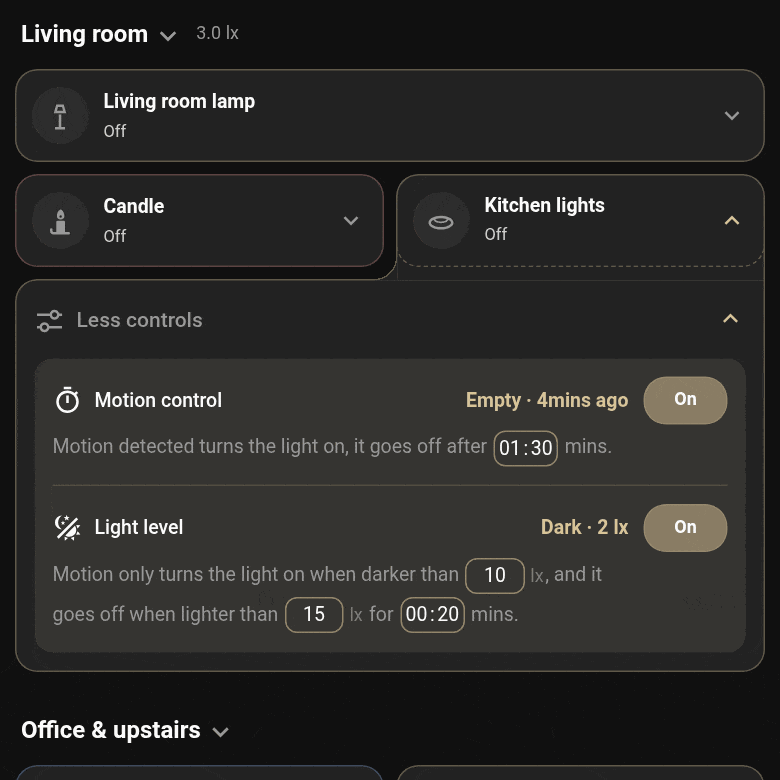

# Countdown, dim and light level

## Countdown and dim

When the room empties (or the door closes, or the vibration stops), the **motion timeout** starts (5 minutes unless you change it). The ring
round the card's icon drains as it counts down, and the card says "Off in 4:12".

For the last part of the countdown (the **dim before off**, 1 minute by default, at most three
quarters of the timeout) the light dims to half. That's the warning: if you're still there, move,
(or open the door again) and the brightness goes back to what it was. If nobody does, the light goes off, and the next
time it comes on it's at its own brightness, not the dimmed one, even if Home Assistant restarted
in between. Lights that can't be dimmed skip the dim and just count down.

## Light level

Give a light one or more light sensors and it follows the daylight:

- Its sensors only turn it on while the room is **dark** (below *Dark below*).
- Once the room has been **light** (above *Light above*) for the *Off when light* time, it goes
  off, with its own countdown on the card. The gap between the two levels stops it flickering on
  and off at dusk.
- With Motion control switched off, the light level works by itself: on when it gets dark, off
  when it gets light. A grey day may never count as light, so it never gets dark either: give it
  a *Turn on when this ends, if it's still dark* entity under Advanced options (for example a
  morning time-of-day helper) and, when that turns off, the light comes on if it still counts as
  dark, unless it already came on for the dark since the entity turned on.

Several light sensors are averaged, so a room with no sensor of its own can follow the rooms
around it.

[← Back to the README](../README.md)
