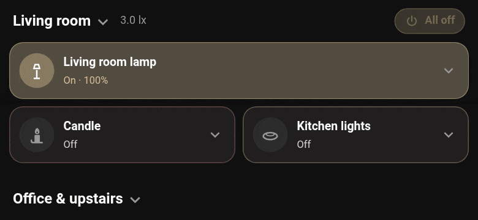

# Pause

Sometimes the house shouldn't decide. Add the entities that mean "leave this light alone" (guest
mode, a party, nobody home) and Knit stands down while they're on. The card says **Automations
paused**, so nobody wonders why the light didn't go off. When the pause ends, Knit picks up from
where things are now.

Pause entities are under **Advanced options** when you add a device or open Configure. With two or
more, Configure asks whether any one of them pauses it, or only all of them together.

[← Back to the README](../README.md)
