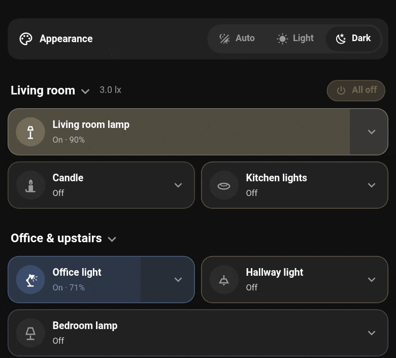
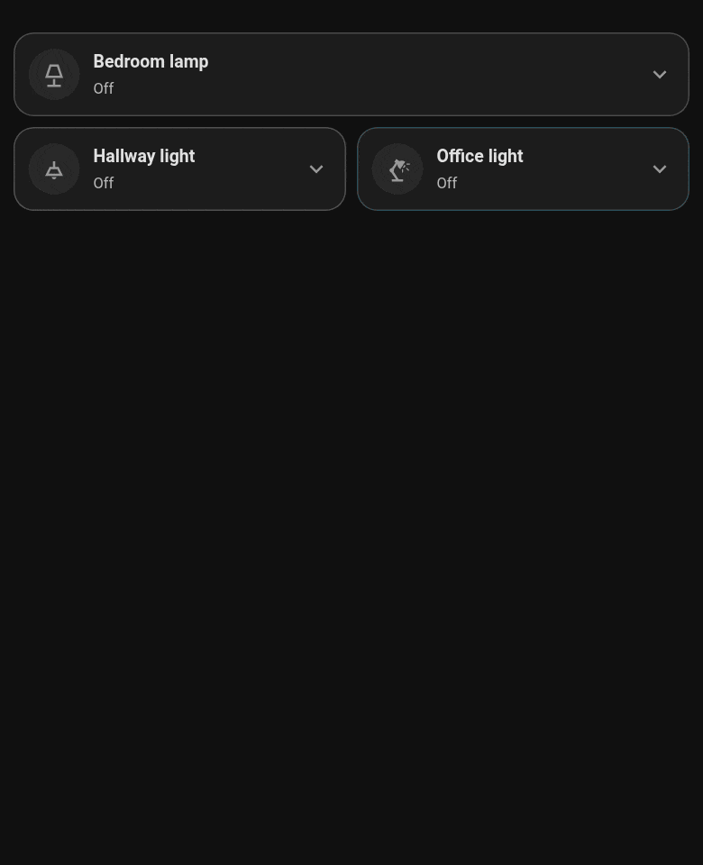
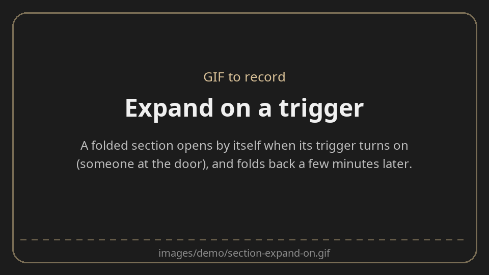

# The section card

The **section card** is a header for a group of cards. Tap its title and the cards below it fold
away; tap again and they're back. A subtitle (or an entity's state) sits beside the title, and an
optional button on the right acts on anything you like ("All off").



**Making a group collapsible** takes one card. Edit the dashboard, press **+** in the section,
choose **By card**, search for **Knit Section**, give it a title and save. A new card lands at the
bottom of its section, so drag the header to the top: every card below it, down to the next
section card or the end of the section, now folds under it. Leave edit mode and tap the title.
(While you're editing, nothing is folded, so you can always reach your cards.)



A section can hold more than one header: put a second section card further down and the cards
under each fold separately.

## Expand on a trigger

A section can stay folded until it matters. With **expand on**, it opens by itself while an
entity is in a state you choose, and stays open for a few minutes after: the cameras when
someone's at the door, the heating when a window is open, the laundry when a wash has finished.
Then it folds itself away again.



## Editor and YAML

The visual editor shows the title and subtitle; the **Button** and **Advanced options** (a subtitle
from an entity, how it opens) fold away beneath.

Put it first in a section of a sections view. It folds the cards below it in that section, up to
the next section card. Everything shows while the dashboard is being edited.

```yaml
type: custom:knit-section
title: Lights
subtitle: Click to expand          # shown while folded; or subtitle_entity: an entity's state, always
collapsed_by_default: false        # true: folded on every load (otherwise as it was last left)
expand_on:                         # optional: opens by itself, then folds back
  entity: binary_sensor.front_door_person
  state: "on"                      # while the entity is in this state (default on) ...
  minutes: 10                      # ... and for this long after
  minutes_entity: input_number.x   # or take the minutes from an entity
                                   # (a time entity: for this long after that time)
button:                            # optional button on the right
  entity: [light.a, switch.b]      # one or more, any domain: automations run, scripts and
  name: All off                    # scenes start, buttons press
  icon: mdi:power
  action: turn_off                 # toggle | turn_on | turn_off
  show: when_on                    # always | when_on (while any of them is on)
```

[← Back to the README](../README.md)
